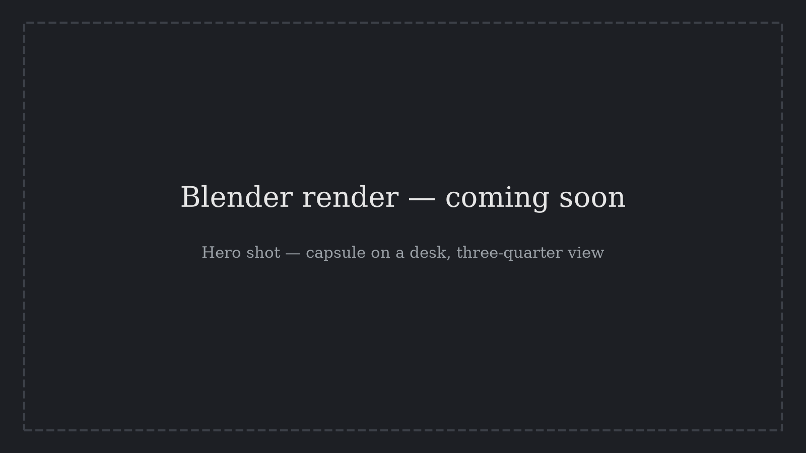
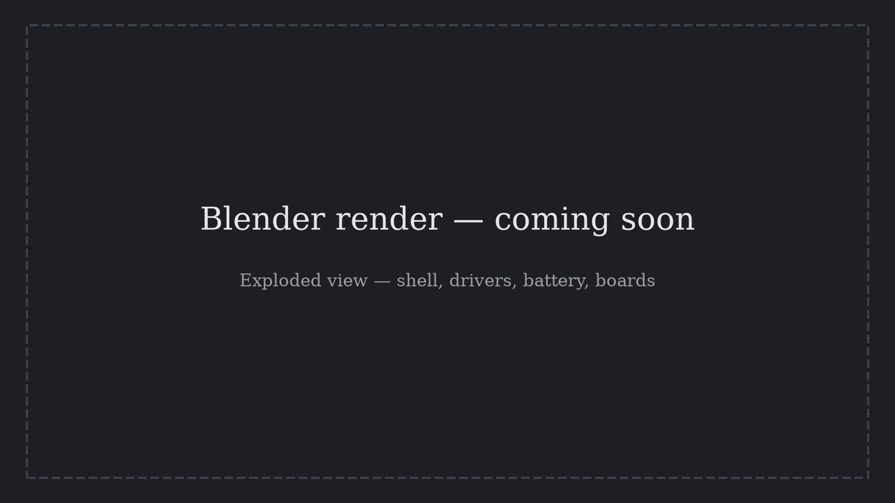
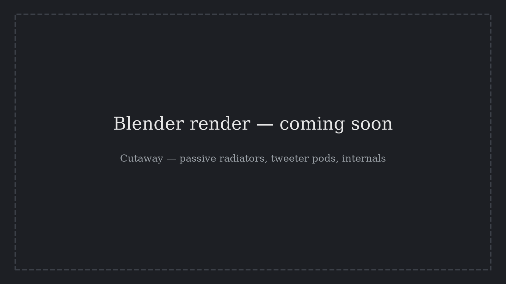

# Vibe hardware: a portable stereo Bluetooth speaker designed with LLM agents



A JBL Flip/Charge-class portable speaker, designed end to end with Claude Code agents and one human making the calls: requirements, part selection, circuit specs, KiCad schematic, simulations (acoustic BEM/FEM, SPICE, PDN), mechanical packaging and, next, PCB layout. The full story, including what went wrong, is in the write-up: [`docs/build/design_doc.pdf`](docs/build/design_doc.pdf). An interactive page explaining every simulation is in [`docs/viz/`](docs/viz/) (open `index.html`).

## The speaker

- **Stereo 2-way, bi-amped:** 2× Dayton ND65-8 woofers, 2× Peerless OT19NC00-04 tweeters (angled up 40°), 2× Dayton DMA58-PR passive radiators on the end caps. Bass to ~64 Hz (−3 dB), ~90 dB pink noise at 1 m on a desk.
- **Electronics:** ESP32-WROVER-E (Bluetooth A2DP + Wi-Fi EQ web UI), 2× TI TAS5805M class-D amps with DSP crossover/EQ/limiters, 18 V TPS61178 boost, BQ25792 buck-boost charger with USB-C PD (CH224Q), 2S Li-ion pack with on-board protection and balancing.
- **UI:** 1.28" round display, encoder, MEMS mic for placement-aware auto-EQ, power button.
- **Mechanics:** Ø95 × 210 mm capsule, five FDM-printed PETG parts, ~0.85 L net volume, ~12.8 h at moderate volume.
- **Manufacturing:** 4-layer main board assembled by JLCPCB from LCSC parts.

| | |
|---|---|
|  |  |
|  |  |

*Renders are placeholders until the Blender pass (after PCB layout and detailed CAD).*

## Status

| Stage | State |
|---|---|
| Requirements, research, part selection | Done |
| Circuit specs (power, signal, UI board) | v1.3 / v1.2 |
| Schematic | **v0.2**, release review passed with no blockers (`docs/review/`) |
| Simulations: acoustics, SPICE, PDN | Done (pre-layout) |
| Mechanical concept | Done (`mech/concept/`) |
| PCB layout | In progress |
| Thermal, post-layout PDN, EM hot-loop sims | After layout |
| Blender renders, build, REW measurements, firmware | Planned |

## Repository layout

| Path | Contents |
|---|---|
| `docs/requirements.md` | Single source of truth for product decisions |
| `docs/spec_*.md` | Pin-exact circuit specifications |
| `docs/eco_*.md`, `docs/review/` | Engineering changes and release reviews |
| `docs/process_log.md` | How the agents were orchestrated, and what went wrong |
| `docs/layout_principles.md` | Layout rules the PCB must meet |
| `docs/writeup/`, `docs/build/` | LaTeX write-up and its PDF |
| `docs/figures/` | All simulation figures (PDF + PNG) |
| `docs/renders/` | Blender renders (placeholders for now) |
| `research/` | Parts, drivers, firmware/tool research |
| `hw/mainboard/` | KiCad project; `hw/releases/` frozen snapshots; `hw/lib/` custom symbols/footprints |
| `mech/concept/` | Scripted FreeCAD packaging model, STEP, board envelopes |
| `sim/` | Acoustic, SPICE and PDN simulations (`run_all.sh` in each) |
| `kb/datasheets/` | Datasheet layout notes with page citations (vendor PDFs not included) |
| `tools/` | Helpers, e.g. the TAS5805M biquad encoder |

## Reproducing the simulations

```sh
python3 -m venv .venv && .venv/bin/pip install -r requirements-sim.txt
sim/acoustics/run_all.sh    # BEM runs take ~1 h on a laptop CPU
sim/spice/run_all.sh        # needs ngspice (brew install ngspice)
```

Large intermediate results (`*.npz`, raw waveforms) are not committed; the scripts regenerate them.
